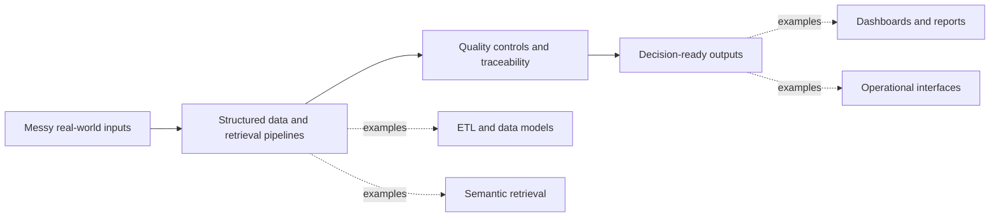

# Jordan Goh — Engineering Work Samples

I am **Jordan Goh**, a Computing Science student specialising in **AI, data engineering, and analytics**. I enjoy turning fragmented information into dependable systems: ingestion pipelines, retrieval workflows, analytical data models, and interfaces that help people make better decisions.

This repository is a recruiter-friendly index of selected engineering work. Each case study focuses on the problem, system decisions, my contribution, and what I learned—not a chronological project diary.

> [!NOTE]
> Some work was completed in commercial or industry-linked environments. These write-ups intentionally omit confidential data, internal architecture, credentials, and proprietary implementation details.

## Selected Work

| Project | Engineering focus | Stack / concepts | Evidence |
|---|---|---|---|
| **InternSearch** | Multi-source ingestion, configurable scoring, KPI monitoring, and automated reporting | Python, SQLite, REST APIs, GitHub Actions, Docker, pytest | [View repository](https://github.com/jordecoder/internsearch) |
| **Oraphim** | Full-stack maritime investigation platform with spatial data and analyst workflows | SvelteKit, FastAPI, PostgreSQL/PostGIS, MongoDB, MapLibre GL | [Team repository (access-controlled)](https://github.com/ncht88/2003_oraphim) |
| **Analytics Platform for Educational Institutions** | Requirements-to-data traceability, physical data modelling, dashboard mapping, and ETL planning | erwin Data Modeler, MicroStrategy, Excel, draw.io | [Read case study](case-studies/azendian-analytics-platform/README.md) |
| **Agentic RAG Platform** | Semantic retrieval, query rewriting, evidence filtering, synthesis, and report generation | GPT-4o, LlamaIndex, LanceDB, Gradio | [Read case study](case-studies/nvidia-agentic-rag/README.md) |

## Engineering Through-Line

Across these projects, I repeatedly work at the boundary between data and product:

- translating stakeholder needs into schemas, transformations, and interfaces;
- designing traceable flows from source data to user-facing outputs;
- making quality, observability, and failure handling part of the design;
- communicating technical systems clearly enough for another team to implement or extend.

## Capability Snapshot

| Area | What I have built or practised |
|---|---|
| **AI engineering** | Agentic RAG workflows, semantic retrieval, query refinement, relevance filtering, evidence synthesis |
| **Data engineering** | Heterogeneous source ingestion, normalization, data mapping, ETL specifications, relational and spatial storage |
| **Analytics engineering** | Dimensional thinking, dashboard-to-attribute mapping, KPI definitions, model-monitoring data structures |
| **Backend engineering** | Python services and pipelines, FastAPI APIs, authentication, data access, scheduled automation |
| **Product delivery** | Requirements discovery, iterative design reviews, cross-team handoffs, technical documentation |

## How to Review This Portfolio

For a quick scan, start with the project table above. For deeper technical reasoning:

1. Read the [Azendian analytics case study](case-studies/azendian-analytics-platform/README.md) for requirements, modelling, and ETL design.
2. Read the [NVIDIA RAG case study](case-studies/nvidia-agentic-rag/README.md) for AI retrieval and evidence-synthesis work.
3. Open [InternSearch](https://github.com/jordecoder/internsearch) for a self-contained Python data pipeline.
4. Open [Oraphim](https://github.com/ncht88/2003_oraphim) for a larger full-stack, team-based system.

> [!TIP]
> Oraphim is currently hosted in an access-controlled team repository. Its link is included for project traceability; the public case studies above can be reviewed without access.

---

[GitHub profile](https://github.com/jordecoder) · [InternSearch](https://github.com/jordecoder/internsearch) · [Oraphim](https://github.com/ncht88/2003_oraphim)
