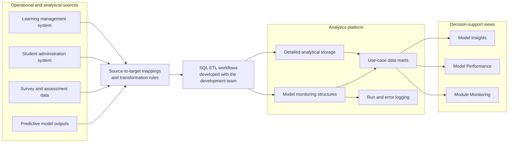
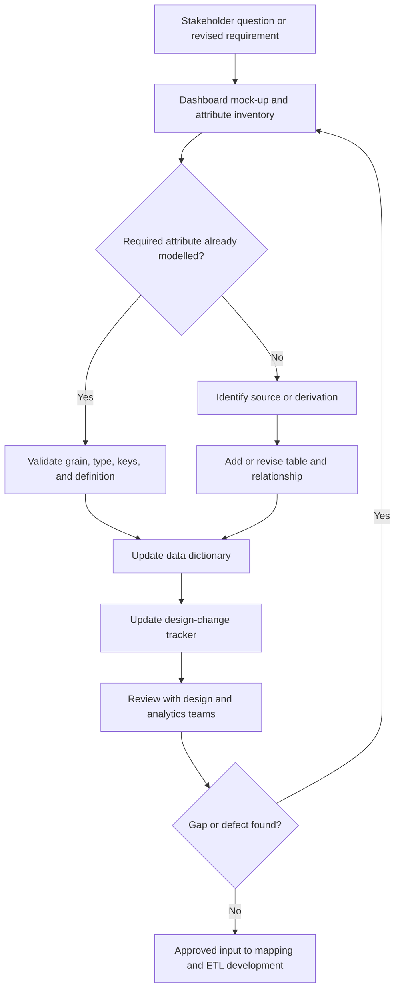
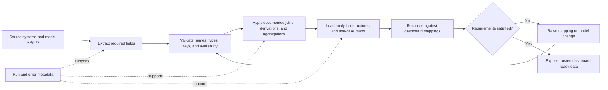

# Analytics Platform for Educational Institutions

**Organisation:** Azendian Solutions · **Role:** Data Engineering Intern · **Project:** Analytics platform design and ETL for higher-education use cases

> [!IMPORTANT]
> This case study is rewritten from an internship report as a concise engineering portfolio piece. It describes system design and my contribution at a high level; client-specific data, detailed schemas, and proprietary artefacts are intentionally excluded.

## Executive Summary

Educational institutions generate useful information across learning management systems, student administration systems, surveys, assessments, and analytical models. When those sources remain fragmented, staff spend time reconciling data manually, definitions drift between reports, and decision-makers struggle to move from historical reporting to actionable insight.

I contributed to the design of an analytics platform intended to provide a more consistent data foundation for higher-education analytics. My scope covered three use cases:

- **Model Insights** — explaining the features and student-group patterns associated with a predictive model;
- **Model Performance** — monitoring model health, evaluation indicators, and data drift;
- **Module Monitoring** — helping lecturers and module leaders examine module, cohort, and student performance.

My work sat between requirements discovery and implementation. I translated dashboard concepts into attribute requirements, designed and refined physical data models, maintained data dictionaries and design-change records, mapped source fields to targets, documented transformation logic, and developed SQL-based ETL workflows and reporting datasets that implemented those mappings, working with the development team.

The result was a set of reviewed, traceable design specifications, and the SQL ETL that implemented them, connecting stakeholder questions to dashboards, schemas, and downstream data pipelines.

## Business Problem

The platform addressed three connected problems.

| Problem | Operational effect | Design response |
|---|---|---|
| Data spread across multiple operational systems | Analysts repeatedly collect and reconcile similar information | Define a consolidated analytical layer and shared data definitions |
| Manual, error-prone data preparation | Inconsistent fields and transformations reduce trust in reports | Map source-to-target lineage and transformation rules explicitly |
| Limited decision support | Teams can see what happened but have less support for diagnosing performance or acting early | Organise data around model monitoring and module-level analytical use cases |

The desired platform needed to behave as a **single source of truth** while remaining flexible enough to serve different institutions. This created a central engineering tension: the core design had to be reusable, but the final analytical layer still needed to accommodate institution-specific dashboard requirements.

## Scope and Ownership

Clear ownership mattered because the project involved analytics, design, and development functions.

| In my scope | Adjacent team responsibility |
|---|---|
| Translate mock-ups and requirements into attribute lists | Gather broader client and stakeholder input |
| Design and refine data models for assigned use cases | Develop the predictive analytics model |
| Create data dictionaries and design-change records | Build production dashboard visualisations |
| Map dashboard elements to target attributes | Implement metadata and presentation layers |
| Specify source-to-target mappings and develop SQL-based ETL workflows and reporting datasets | Run production ETL workflows |
| Visualise data dependencies and support handoff | Implement infrastructure and databases |

> [!NOTE]
> My contribution was the **design contract** and the SQL ETL that implemented it. Production dashboard visualisations were built by an adjacent team.

## Analytics Platform Design

At a high level, operational and model-generated data would be transformed into use-case-oriented analytical structures, then exposed through dashboards.

The platform design separated two broad data paths:

- **Model Insights and Model Performance** consumed outputs from an analytical engine. Their design covered inputs, training outputs, scoring outputs, evaluation outputs, dashboard-facing data, and operational run/error logs.
- **Module Monitoring** drew from detailed institutional data without requiring a predictive model. Its structures brought together module, component, survey, learning-platform activity, coursework, quiz, cohort, and student-level information.

This separation prevented a misleading one-size-fits-all model. The two paths had different sources and processing semantics, even though both ultimately supported analytical dashboards.

## Requirements Gathering

Requirements arrived incrementally through stakeholder discussions and dashboard mock-ups. Relevant users included institutional management, lecturers, and module leaders. The analytics team captured the intended questions and prepared mock data or visual concepts; I then converted those concepts into data requirements.

For each dashboard component, I worked backwards:

1. What question is the user trying to answer?
2. Which dimensions, measures, filters, and levels of detail are required?
3. Which attributes already exist in the design?
4. Which values must be derived or aggregated?
5. Where should missing attributes enter the model?

This exposed gaps that a visual mock-up alone could hide. A stacked chart, for example, requires not only a numerical measure but also a grouping attribute and possibly a legend dimension. Global filters also need stable keys and consistent granularity across every visual they affect.

Requirements were treated as a living input rather than a one-time document. When terminology or expected behaviour changed, I traced the change through the attribute list, physical model, data dictionary, dashboard mapping, and source-to-target mapping.

## Data Modelling

I used erwin Data Modeler to design and review physical data structures, including tables, attributes, primary keys, foreign keys, data types, sizes, and nullability. The objective was not just to draw entities; it was to create a model that could support the exact grain and joins required by the analytical use cases.

Three details consistently required care:

- **Grain:** student, cohort, module, model run, training cohort, and scoring cohort measures could not be joined casually without duplicating records.
- **Reusable versus client-specific structures:** generic model-monitoring structures supported product reuse, while dashboard-facing structures captured institution-specific requirements.
- **Traceability:** every material model change needed matching updates in the dictionary, mapping files, and change record.

Reviews were incremental. Tables were checked with the design team and other project stakeholders before I moved further downstream. This shortened the feedback loop and helped surface wrong data types, incorrect sizes, naming inconsistencies, missing attributes, and joins that could multiply rows.

## Data Mapping

The source-to-target mapping was the implementation bridge. For every target attribute, the mapping recorded its source table and field, expected transformation, and destination. This allowed developers to understand intent without reconstructing it from dashboards or meetings.

A simplified mapping contract looked like this:

| Target concept | Source concept | Transformation category | Validation concern |
|---|---|---|---|
| Student count by class | Student identifier | Distinct count or agreed aggregation | Correct class-level grain |
| Module performance | Assessment results | Aggregate by module and cohort | Comparable periods and weighting |
| Learning activity | Access events | Count or duration calculation | Event completeness and time window |
| Model health status | Evaluation metrics | Threshold-based classification | Threshold definition and model run |

I documented transformation intent before implementing it in SQL. Even a simple aggregation needed an explicit business definition: whether it was a raw count or distinct count, the grouping level, the time window, and the handling of missing data could all change the dashboard result.

## Dashboard Mapping

Dashboard mapping created end-to-end traceability from visual elements to the data model. Each chart, KPI, filter, and legend was decomposed into its required attributes and matched against the data dictionary.

The mapping classified fields as dimensions, facts, or measures and recorded any required transformation. If an attribute could not be found, the team either revised the model or reconsidered the dashboard requirement. This made dashboard completeness reviewable rather than subjective.

The three use cases placed different demands on the model:

- **Model Insights:** performance groups, categorical and numerical feature comparisons, trends over semesters, and student-group drill-downs.
- **Model Performance:** model-health indicators, evaluation history, group-level metrics, confusion-matrix inputs, and data-drift details.
- **Module Monitoring:** module and cohort summaries, component results, survey scores, learning-platform activity, submissions, prerequisite performance, and student drill-downs.

This work taught me that dashboards are data contracts in disguise. A polished mock-up can still be technically incomplete until every mark, filter, and interaction has a defined source and grain.

## ETL Development and Handoff

I developed SQL-based ETL workflows and reporting datasets from these mappings, working with the development team, and prepared the data-flow artefacts they needed to extend the pipelines accurately.

The accompanying data-flow diagrams showed upstream and downstream table dependencies. They were particularly useful when the model-monitoring use cases moved through analytical-engine stages, while Module Monitoring followed a more direct path from detailed storage to use-case structures.

I also delivered knowledge-transfer sessions on how to interpret the data dictionary and mapping documents. That handoff reduced ambiguity: developers could identify target fields, sources, and transformation logic in one place, then raise focused questions when implementation exposed a gap.

## Technologies Used

| Technology | How I used it |
|---|---|
| **SQL** | Wrote ETL workflows and reporting datasets that implemented the source-to-target mappings |
| **erwin Data Modeler** | Designed and reviewed physical models, tables, keys, relationships, and attributes |
| **Microsoft Excel** | Maintained attribute lists, data dictionaries, change trackers, dashboard mappings, and source-to-target mappings |
| **MicroStrategy** | Interpreted dashboard mock-ups and mapped their analytical requirements |
| **draw.io** | Communicated table dependencies and planned data flows |
| **Predictive analytics concepts** | Model training/scoring/evaluation outputs, balanced accuracy, feature analysis, and data drift |

## My Contributions

- Converted dashboard mock-ups into structured attribute inventories for three analytical use cases.
- Designed and refined physical data models spanning model-monitoring and module-monitoring domains.
- Documented attribute meaning, types, keys, nullability, sources, targets, and transformation logic.
- Created dashboard mappings that connected every visual requirement to modelled data.
- Produced source-to-target mappings and data-flow diagrams for ETL implementation.
- Developed SQL-based ETL workflows and reporting datasets that implemented the mappings.
- Maintained design-change traceability as requirements and naming evolved.
- Participated in iterative model reviews and corrected modelling gaps before downstream implementation.
- Explained design artefacts to the development team during knowledge transfer.

## Challenges and Engineering Decisions

### Evolving requirements

Late naming and attribute changes could cascade across several manually maintained documents. I responded by tracing each change through the model, dictionary, dashboard mapping, and data mapping instead of updating only the most visible artefact.

### Manual consistency checks

Spreadsheet-based documentation was flexible but error-prone. I introduced checks using spreadsheet lookup and error-handling functions to find inconsistencies. The larger lesson was that shared metadata should ideally be generated from, or validated against, a canonical machine-readable definition.

### Understanding a generic analytical-engine design

The model-monitoring structures initially felt less intuitive because they were deliberately generic rather than tailored to one university. Discussions with my supervisor and the analytics team helped me understand the product boundary: reusable engine outputs belonged in the shared design, while institution-specific fields belonged closer to the dashboard layer.

### Designing without live production data

Domain research and mock data made progress possible, but they could not reveal every distribution, nullability issue, or source-system anomaly. We used iterative review to compensate, while recognising that representative data profiling would strengthen future designs.

## Lessons Learned

1. **Traceability is a system feature.** Requirements, dashboard elements, attributes, transformations, and tables need explicit links; otherwise changes become guesswork.
2. **Grain should be decided before joins.** Many analytical defects begin when measures from different levels are combined without a clear contract.
3. **Documentation is part of delivery.** A model is only useful when analytics and development teams can interpret it consistently.
4. **Generic platforms need deliberate extension points.** Reuse and client fit are compatible when the boundary between shared structures and local requirements is clear.
5. **Manual metadata does not scale cleanly.** Future work should validate or generate dictionaries and mappings from a canonical schema, with automated checks in version control.
6. **Representative data changes the quality of design.** Early profiling of realistic, anonymised datasets would reveal edge cases sooner and reduce late rework.

## What I Would Improve Next

I would move the design artefacts toward a metadata-as-code workflow: store canonical field definitions in a version-controlled format, validate references automatically, and generate human-readable dictionaries and mapping views from the same source. I would also add sample-data profiling and contract tests before ETL implementation, then test the design across a wider range of institutional environments.

These improvements follow directly from the project’s hardest problem: maintaining consistency across many connected artefacts while requirements continued to change.

---

[← Back to portfolio](../../README.md) · [Next: Agentic RAG Platform →](../nvidia-agentic-rag/README.md)
