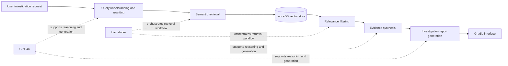
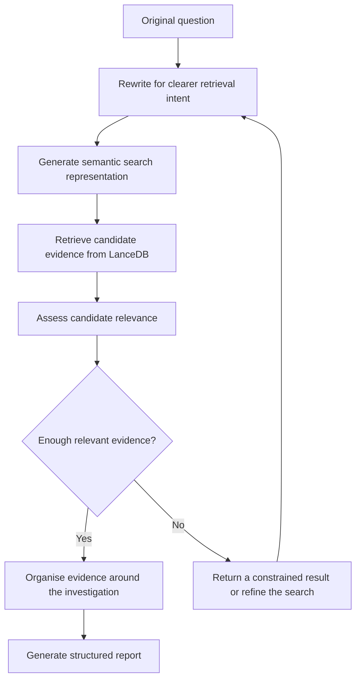

# Agentic Retrieval-Augmented Generation Platform

**Organisation:** NVIDIA (SIT-NVIDIA AI Centre) · **Role:** AI Engineer Intern · **Focus:** Agentic retrieval, evidence processing, and investigation-report generation

> [!IMPORTANT]
> This is a deliberately sanitised case study. It describes the engineering approach at a high level and does not include confidential datasets, prompts, configurations, evaluation results, deployment details, or partner architecture.

## Executive Summary

I built an **Agentic Retrieval-Augmented Generation (RAG) platform** as an AI Engineer Intern with NVIDIA at the SIT-NVIDIA AI Centre. The platform combined GPT-4o, LlamaIndex, LanceDB, and Gradio to help users investigate questions against an approved knowledge collection and turn retrieved evidence into a structured report.

The core engineering work went beyond a single retrieve-then-answer call. The workflow refined the user’s question, performed semantic retrieval, filtered results for relevance, synthesised evidence, and generated an investigation report. The agentic structure made each reasoning stage explicit and allowed the system to treat retrieval quality as part of the application rather than as an invisible database lookup.

No proprietary implementation details or performance claims are included here.

## Problem

Investigation-oriented questions are often broader and less precise than ordinary search queries. A user may provide incomplete terminology, combine several sub-questions, or expect a report supported by multiple pieces of evidence. A naive RAG workflow can retrieve semantically similar passages that are not actually useful, then produce a fluent response from weak context.

The platform therefore needed to address a sequence of engineering concerns:

- interpret and refine the user’s investigative intent;
- retrieve semantically relevant evidence from a vector store;
- remove weak or unrelated context before generation;
- synthesise evidence without obscuring where it came from;
- present the result as a usable investigation report;
- keep the interaction accessible through a lightweight user interface.

## Solution

I structured the system as a staged agentic RAG pipeline. GPT-4o supported language reasoning and generation, LlamaIndex coordinated retrieval-oriented application logic, LanceDB provided vector search, and Gradio exposed the workflow through an interactive interface.

The design separated retrieval from answer generation so low-quality evidence could be handled before it reached the synthesis stage. It also separated synthesis from final report presentation: the system first organised the retrieved evidence, then shaped it into a coherent investigation output.

## Retrieval Workflow

This diagram is intentionally conceptual. It explains the responsibilities of the workflow without exposing internal prompts, thresholds, data structures, or deployment topology.

## Technical Contributions

| Area | Contribution |
|---|---|
| **Agentic workflow** | Built a multi-stage RAG flow that made query refinement, retrieval, filtering, synthesis, and report generation distinct responsibilities |
| **Query rewriting** | Added a refinement stage to turn ambiguous user questions into clearer semantic retrieval intent |
| **Semantic retrieval** | Used LlamaIndex with LanceDB to retrieve evidence by meaning rather than exact keyword overlap |
| **Relevance filtering** | Added a gate between retrieval and synthesis so candidate context could be assessed before use |
| **Evidence synthesis** | Combined relevant material into a coherent evidence base for downstream report generation |
| **Report generation** | Used GPT-4o to transform synthesised evidence into a structured investigation report |
| **User interface** | Built a Gradio interface that exposed the workflow without requiring users to operate the retrieval stack directly |

### Technology choices

| Technology | Role in the platform |
|---|---|
| **GPT-4o** | Language reasoning, query refinement, evidence synthesis, and report generation |
| **LlamaIndex** | RAG application and retrieval-workflow orchestration |
| **LanceDB** | Vector storage and semantic similarity search |
| **Gradio** | Interactive application interface |

> [!NOTE]
> The case study identifies product-level responsibilities only. It does not imply a specific hosting model, embedding model, agent framework configuration, or evaluation score.

## Challenges

### Query ambiguity

Investigation requests do not always arrive as search-ready questions. Query rewriting had to preserve the user’s intent while making retrieval more focused. Over-rewriting could narrow the investigation incorrectly; under-rewriting could return diffuse evidence.

### Similarity is not the same as relevance

Vector search can find conceptually related text that still does not answer the question. A dedicated relevance-filtering stage reduced the risk of treating every retrieved passage as equally useful.

### Evidence synthesis

Multiple relevant passages may overlap, disagree in emphasis, or cover different parts of a question. The synthesis stage needed to organise that evidence before producing a report, rather than simply concatenating context.

### Useful output without false confidence

A well-written report can appear authoritative even when retrieval is weak. The workflow therefore treated evidence sufficiency as an engineering concern and allowed constrained behaviour when the available context was inadequate.

### User experience across a multi-stage pipeline

Agentic workflows involve more steps than direct generation. The Gradio layer had to make the process usable while keeping the underlying retrieval and reasoning stages out of the user’s way.

## Lessons Learned

1. **Retrieval quality is an application concern, not only a vector-database setting.** Query formulation and relevance filtering materially shape the evidence given to the model.
2. **Agentic decomposition makes quality controls easier to place.** Distinct stages create natural points for inspection, testing, and fallback behaviour.
3. **Evidence should be organised before it is narrated.** Separating synthesis from report generation produces a clearer mental model and reduces accidental dependence on raw retrieval order.
4. **Good RAG systems need constrained failure modes.** When relevant evidence is insufficient, a limited response is safer than filling gaps with confident prose.
5. **The interface is part of the engineering system.** A technically sound pipeline only becomes useful when users can submit questions and interpret outputs comfortably.
6. **Confidentiality shapes technical communication.** It is possible to explain engineering judgment clearly without disclosing datasets, internal architecture, or partner-sensitive details.

## Confidentiality Statement

This portfolio entry contains only high-level, non-confidential engineering information. It does **not** disclose source documents, organisational data, internal prompts, system configurations, credentials, infrastructure, proprietary workflows, evaluation results, or any partner’s internal architecture. The diagrams are conceptual representations created solely to explain the general RAG workflow.

---

[← Back to portfolio](../../README.md) · [Previous: Analytics Platform Case Study](../azendian-analytics-platform/README.md)
